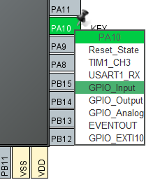
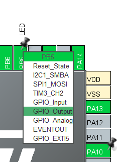
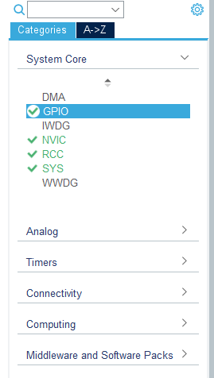
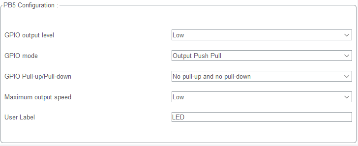
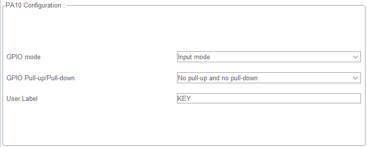

# STM32 HAL GPIO - API Reference

This document provides a complete reference for STM32 HAL GPIO (General Purpose Input/Output) driver functions. The GPIO peripheral allows microcontroller pins to be configured as digital inputs or outputs, enabling interaction with external hardware components like LEDs, buttons, sensors, and other digital devices.

## Overview

The STM32 HAL GPIO driver provides a hardware abstraction layer for controlling GPIO pins across all STM32 microcontroller families. It offers a consistent API regardless of the specific STM32 series you're using (F0, F1, F4, L4, H7, etc.).

### Key Features

- **Flexible Pin Configuration:** Configure pins as input, output, alternate function, or analog
- **Multiple Output Modes:** Push-pull or open-drain output configurations
- **Configurable Pull Resistors:** Internal pull-up, pull-down, or no pull
- **Speed Control:** Adjustable output speed (Low, Medium, High, Very High)
- **Pin Locking:** Prevent accidental pin reconfiguration
- **Interrupt Support:** External interrupt/event configuration (covered separately)
- **Hardware Abstraction:** Consistent API across all STM32 families

---

## GPIO Ports and Pins

### Port Naming Convention

STM32 microcontrollers organize GPIO pins into ports, each containing up to 16 pins:

```
Port A: PA0, PA1, PA2, ..., PA15
Port B: PB0, PB1, PB2, ..., PB15
Port C: PC0, PC1, PC2, ..., PC15
Port D: PD0, PD1, PD2, ..., PD15
Port E: PE0, PE1, PE2, ..., PE15
Port F: PF0, PF1, PF2, ..., PF15
...
```

**Available Ports Vary by Device:**
- Entry-level MCUs: Typically GPIOA-GPIOC
- Mid-range MCUs: Typically GPIOA-GPIOE
- High-performance MCUs: May include GPIOA-GPIOK

---

## STM32CubeMX Configuration

Before using GPIO functions in code, you **MUST** configure the pins using STM32CubeMX or manually in your initialization code.

### CubeMX GPIO Configuration Steps:

1. **Open STM32CubeMX Project**
   - Create new project or open existing one
   - Select your target STM32 microcontroller

2. **Navigate to Pinout & Configuration**
   - Click on "Pinout & Configuration" tab
   - View the chip pinout diagram

3. **Select GPIO Pin**
   - Click on the desired pin in the chip diagram
   - A dropdown menu will appear



4. **Set GPIO Mode**
   - For output pins: Select `GPIO_Output`
   - For input pins: Select `GPIO_Input`
   - For alternate functions: Select appropriate peripheral function
   - For analog: Select `ADC`, `DAC`, or `Analog`



5. **Configure GPIO Settings**
   - Click on "System Core" → "GPIO" in the left panel
   - Select the configured pin
   - Set the following parameters:



   **For Output Pins:**
   - GPIO mode: `Output Push Pull` or `Output Open Drain`
   - GPIO Pull-up/Pull-down: `No pull-up and no pull-down`, `Pull-up`, or `Pull-down`
   - Maximum output speed: `Low`, `Medium`, `High`, or `Very High`
   - Initial output level: `Low` or `High`



   **For Input Pins:**
   - GPIO Pull-up/Pull-down: `No pull-up and no pull-down`, `Pull-up`, or `Pull-down`
   - GPIO mode: `Input mode` (with or without interrupts)



6. **Assign User Label (Optional but Recommended)**
   - Enter a descriptive name (e.g., `LED_RED`, `BUTTON_USER`, `SENSOR_DATA`)
   - This creates readable macros in generated code

7. **Generate Code**
   - Click "Project" → "Generate Code"
   - CubeMX generates initialization code in `main.c` and `gpio.c`

### Example Configuration

**LED on PB5 (Output):**
- GPIO mode: Output Push Pull
- GPIO Pull-up/Pull-down: No pull-up and no pull-down
- Maximum output speed: Low
- User Label: `LED`

**Button on PA10 (Input):**
- GPIO mode: Input mode
- GPIO Pull-up/Pull-down: Pull-up
- User Label: `KEY`

---

## GPIO Pin Definitions

After CubeMX code generation, GPIO pins are defined in `main.h` as macros:

```c
/* User Label Definitions */
#define LED_Pin GPIO_PIN_5
#define LED_GPIO_Port GPIOB

#define KEY_Pin GPIO_PIN_10
#define KEY_GPIO_Port GPIOA
```

These macros are used with HAL GPIO functions throughout your code.

---

## API Functions

### Initialization and Configuration

#### `void HAL_GPIO_Init(GPIO_TypeDef *GPIOx, GPIO_InitTypeDef *GPIO_Init)`

**Description:**  
Initializes GPIO pins according to the specified parameters in the `GPIO_InitTypeDef` structure.

**Parameters:**
- `GPIOx` - GPIO Port (GPIOA, GPIOB, GPIOC, etc.)
- `GPIO_Init` - Pointer to `GPIO_InitTypeDef` structure containing configuration parameters

**Returns:**  
None

**GPIO_InitTypeDef Structure:**
```c
typedef struct {
    uint32_t Pin;       // GPIO pins to be configured (GPIO_PIN_x)
    uint32_t Mode;      // Operating mode (Input, Output, AF, Analog)
    uint32_t Pull;      // Pull-up/Pull-down activation
    uint32_t Speed;     // Output speed (Low, Medium, High, Very High)
    uint32_t Alternate; // Alternate function selection (for AF mode)
} GPIO_InitTypeDef;
```

**Pin Configuration Options:**

| Parameter | Options | Description |
|-----------|---------|-------------|
| **Pin** | `GPIO_PIN_0` to `GPIO_PIN_15`<br>`GPIO_PIN_All` | Pin number(s) to configure |
| **Mode** | `GPIO_MODE_INPUT`<br>`GPIO_MODE_OUTPUT_PP`<br>`GPIO_MODE_OUTPUT_OD`<br>`GPIO_MODE_AF_PP`<br>`GPIO_MODE_AF_OD`<br>`GPIO_MODE_ANALOG` | Input, Output Push-Pull, Output Open-Drain, Alternate Function, Analog |
| **Pull** | `GPIO_NOPULL`<br>`GPIO_PULLUP`<br>`GPIO_PULLDOWN` | No pull, Pull-up, Pull-down |
| **Speed** | `GPIO_SPEED_FREQ_LOW`<br>`GPIO_SPEED_FREQ_MEDIUM`<br>`GPIO_SPEED_FREQ_HIGH`<br>`GPIO_SPEED_FREQ_VERY_HIGH` | Output speed selection |

**Examples:**

```c
// Example 1: Configure PB5 as output (LED)
GPIO_InitTypeDef GPIO_InitStruct = {0};

GPIO_InitStruct.Pin = GPIO_PIN_5;
GPIO_InitStruct.Mode = GPIO_MODE_OUTPUT_PP;
GPIO_InitStruct.Pull = GPIO_NOPULL;
GPIO_InitStruct.Speed = GPIO_SPEED_FREQ_LOW;
HAL_GPIO_Init(GPIOB, &GPIO_InitStruct);

// Example 2: Configure PA10 as input with pull-up (KEY)
GPIO_InitStruct.Pin = GPIO_PIN_10;
GPIO_InitStruct.Mode = GPIO_MODE_INPUT;
GPIO_InitStruct.Pull = GPIO_PULLUP;
HAL_GPIO_Init(GPIOA, &GPIO_InitStruct);

// Example 3: Configure multiple pins at once
GPIO_InitStruct.Pin = GPIO_PIN_0 | GPIO_PIN_1 | GPIO_PIN_2;
GPIO_InitStruct.Mode = GPIO_MODE_OUTPUT_PP;
GPIO_InitStruct.Pull = GPIO_NOPULL;
GPIO_InitStruct.Speed = GPIO_SPEED_FREQ_MEDIUM;
HAL_GPIO_Init(GPIOB, &GPIO_InitStruct);

// Example 4: Using CubeMX-generated labels
GPIO_InitStruct.Pin = LED_Pin;
GPIO_InitStruct.Mode = GPIO_MODE_OUTPUT_PP;
GPIO_InitStruct.Pull = GPIO_NOPULL;
GPIO_InitStruct.Speed = GPIO_SPEED_FREQ_LOW;
HAL_GPIO_Init(LED_GPIO_Port, &GPIO_InitStruct);
```

> [!IMPORTANT]
> - Enable GPIO port clock before calling `HAL_GPIO_Init()` using `__HAL_RCC_GPIOx_CLK_ENABLE()`
> - CubeMX automatically generates this in `MX_GPIO_Init()` function
> - Manual initialization requires explicit clock enabling

**Clock Enabling Examples:**
```c
// Enable clock for GPIO ports
__HAL_RCC_GPIOA_CLK_ENABLE();
__HAL_RCC_GPIOB_CLK_ENABLE();
__HAL_RCC_GPIOC_CLK_ENABLE();
```

---

#### `void HAL_GPIO_DeInit(GPIO_TypeDef *GPIOx, uint32_t GPIO_Pin)`

**Description:**  
De-initializes the specified GPIO pins, resetting them to their default state (analog mode with no pull resistors).

**Parameters:**
- `GPIOx` - GPIO Port (GPIOA, GPIOB, GPIOC, etc.)
- `GPIO_Pin` - GPIO pin(s) to be de-initialized (GPIO_PIN_x or combination)

**Returns:**  
None

**Default State After De-initialization:**
- Mode: Analog (high impedance)
- Pull: No pull-up/pull-down
- Speed: Low
- Output level: Undefined

**Examples:**

```c
// Example 1: De-initialize single pin
HAL_GPIO_DeInit(GPIOA, GPIO_PIN_5);

// Example 2: De-initialize multiple pins
HAL_GPIO_DeInit(GPIOB, GPIO_PIN_0 | GPIO_PIN_1 | GPIO_PIN_2);

// Example 3: De-initialize entire port
HAL_GPIO_DeInit(GPIOC, GPIO_PIN_All);

// Example 4: Using CubeMX-generated labels
HAL_GPIO_DeInit(LED_GPIO_Port, LED_Pin);
```

**Use Cases:**
- Releasing pins before entering low-power mode
- Reconfiguring pins for different functionality
- Disabling unused peripherals to save power
- Troubleshooting pin configuration issues

> [!NOTE]
> - De-initialization does NOT disable the GPIO port clock
> - After de-initialization, pins are in analog mode (lowest power consumption)
> - Re-initialization requires calling `HAL_GPIO_Init()` again

# 🌟 Support Me
If you found this repository useful:
- Subscribe to my [YouTube Channel](https://www.youtube.com/@aKaReZa75).
- Share this repository with others.
- Give this repository and my other repositories a star.
- Follow my [GitHub account](https://github.com/aKaReZa75).

  
# ✉️ Contact Me
Feel free to reach out to me through any of the following platforms:
- 📧 [Email: aKaReZa75@gmail.com](mailto:aKaReZa75@gmail.com)
- 🎥 [YouTube: @aKaReZa75](https://www.youtube.com/@aKaReZa75)
- 💼 [LinkedIn: @akareza75](https://www.linkedin.com/in/akareza75)
